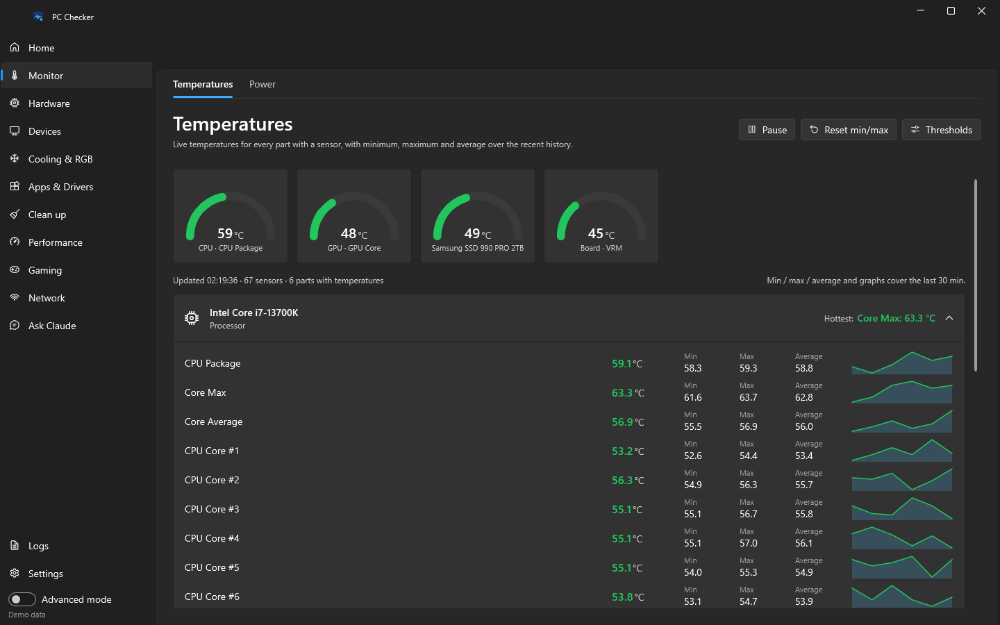
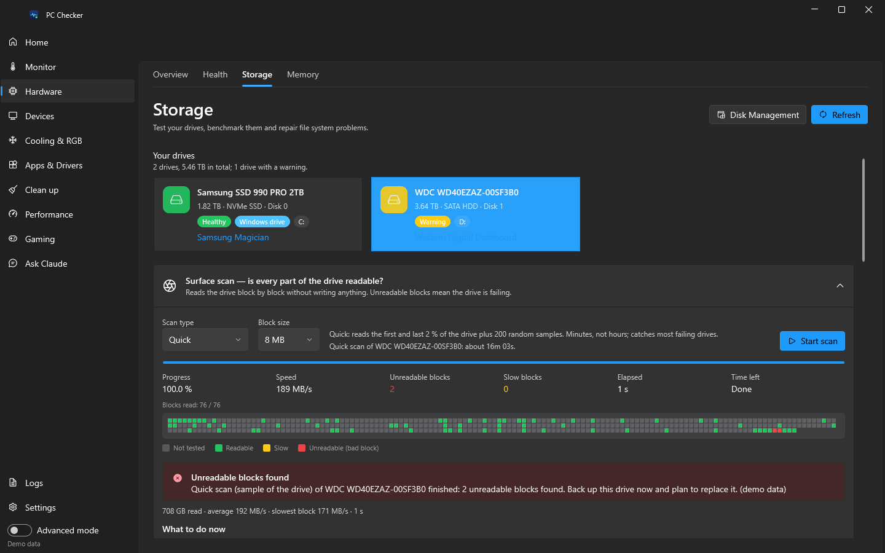
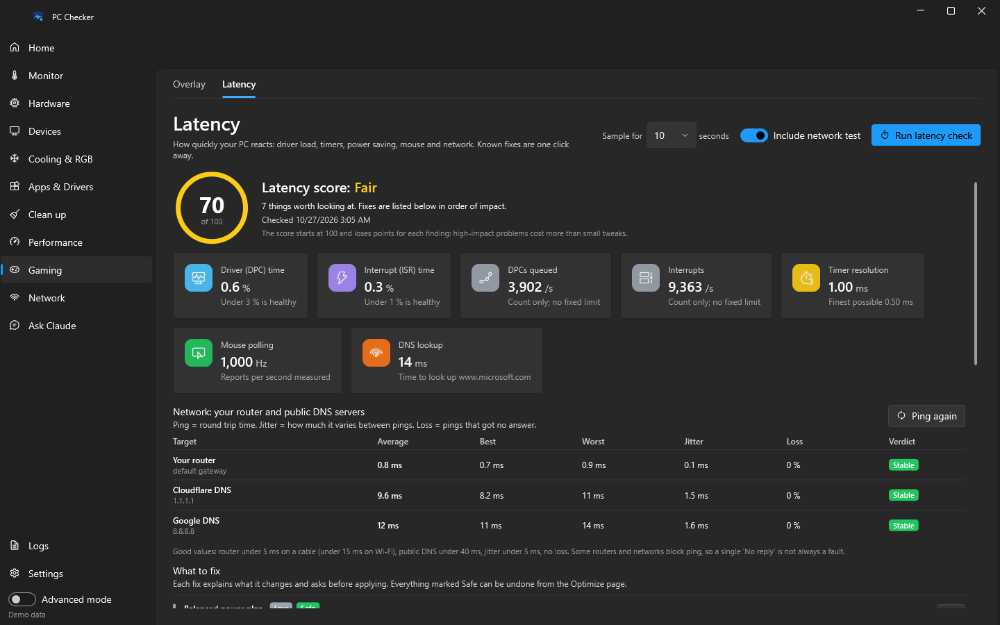
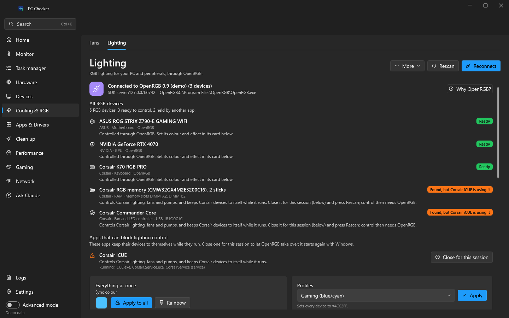
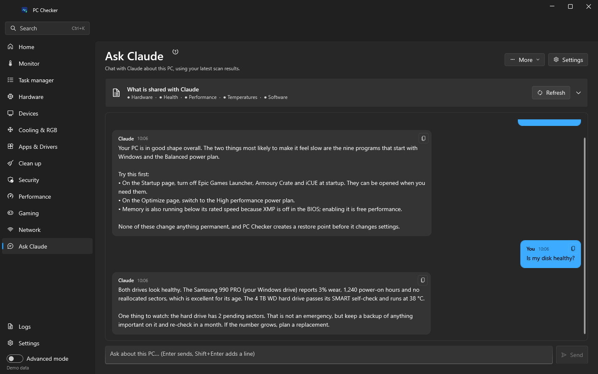

<p align="center">
  
</p>

<p align="center">
  <a href="https://github.com/Connor-Moyle/Pc-Checker/actions/workflows/ci.yml"></a>
  <a href="https://github.com/Connor-Moyle/Pc-Checker/releases/latest"></a>
  <a href="LICENSE"></a>
  
  
</p>

PC Checker is a free, open-source toolkit for Windows 11 that puts everything
about your PC in one place: a full hardware inventory, health checks,
temperatures and power, fan curves, RGB lighting, storage and memory testing,
display, audio, keyboard and mouse settings, drivers, software cleanup, startup
and performance tuning, a latency checker with known fixes, overclocking with
safety rails, an in-game overlay, and a built-in Claude assistant that can
explain what it finds. Every change is confirmed first, protected by a restore
point and written to a journal with an undo hint.

## Contents

- [Download](#download)
- [Screenshots](#screenshots)
- [Feature tour](#feature-tour)
- [Hardware support matrix](#hardware-support-matrix)
- [Safety first](#safety-first)
- [Claude assistant](#claude-assistant)
- [Building from source](#building-from-source)
- [Project structure](#project-structure)
- [Contributing](#contributing)
- [Roadmap](#roadmap)
- [Acknowledgements](#acknowledgements)
- [License](#license)

## Download

**[Download PcChecker.exe](https://github.com/Connor-Moyle/Pc-Checker/releases/latest/download/PcChecker.exe)**
and double-click it. That is the whole install: one file, nothing to set up, and .NET is built in. Run it from
your Downloads folder, a tools folder or a USB stick.

Every release on the [Releases page](https://github.com/Connor-Moyle/Pc-Checker/releases) is that single
`PcChecker.exe`, with its SHA-256 checksum in the release notes. The app **updates itself**: when a new version is
out it downloads the new exe, checks the checksum, swaps it in and restarts (Settings → Updates; pick the Beta
channel to get pre-releases).

**Requirements**

- Windows 11, or Windows 10 version 22H2. 64-bit only.
- No separate .NET install: the .NET 8 runtime is built into `PcChecker.exe`.
- Administrator rights. The app asks for them on every start because reading
  SMART data, controlling fans, installing drivers, cleaning system folders,
  changing services, scheduling `chkdsk` and applying GPU clocks all need
  them. It does not install a service and nothing runs when it is closed.

**About SmartScreen.** Releases are not yet signed with a code-signing
certificate, so the first time you run a new version Windows may show
*Windows protected your PC*. Click **More info → Run anyway**. You can confirm
the file came from this repository by comparing its SHA-256 (`Get-FileHash .\PcChecker.exe`) with the one in
the release notes.

**First run**

1. Accept the administrator prompt.
2. The Dashboard runs a quick health check and shows live temperatures. Click
   **Full scan** to fill every page (hardware, health, performance, software,
   drivers).
3. Open **Settings** to pick a theme, decide whether a restore point is created
   before changes (on by default) and, if you want it, turn on **Advanced
   mode** to reveal the riskier tools.
4. Want to look around without touching anything? Run `PcChecker.exe --demo`
   to explore every page with sample data. See
   [docs/DEMO-MODE.md](docs/DEMO-MODE.md).

## Screenshots

Real screenshots of the app, captured automatically on a Windows runner from demo mode (sample data from a
gaming desktop) every time the app changes. The full set of every page is in
[`docs/screenshots`](docs/screenshots).

<p align="center">
  
</p>

<table>
  <tr>
    <td width="50%"><br><sub>Temperatures</sub></td>
    <td width="50%"><br><sub>Fans</sub></td>
  </tr>
  <tr>
    <td width="50%"><br><sub>Overclock</sub></td>
    <td width="50%"><br><sub>Storage</sub></td>
  </tr>
  <tr>
    <td width="50%"><br><sub>Latency</sub></td>
    <td width="50%"><br><sub>Lighting</sub></td>
  </tr>
  <tr>
    <td width="50%"><br><sub>Health</sub></td>
    <td width="50%"><br><sub>Ask Claude</sub></td>
  </tr>
</table>

## Feature tour

The side menu has a dozen sections, and a section with several pages shows
them as tabs, so you always know where you are. The full
page-by-page detail, including what every button does and each page's
limitations, is in [docs/FEATURES.md](docs/FEATURES.md).

### Overview

| Page | What it does |
|---|---|
| **Dashboard** | Health score, live CPU/GPU temperature, memory and power tiles, active alerts, quick actions (full scan, clean up, check drivers, optimize), a summary of this PC, the last few journal entries and a collapsible hardware-support table. Export report sits under *More*. |

### Monitoring

| Page | What it does |
|---|---|
| **Temperatures** | Live readings for every sensor your hardware exposes (CPU, GPU, drives, motherboard/VRM, memory, PSU, AIO), with gauges, min/max/average, sparklines, thresholds and alerts. Advanced mode shows every sensor kind (loads, clocks, fans, voltages). |
| **Power** | Per-component watts where sensors exist, an estimated total (clearly marked as an estimate when there is no PSU sensor), battery discharge, session energy and cost at your electricity price, and power-plan switching. |
| **Overlay** | A click-through, always-on-top in-game panel. Pick metrics, corner or custom position, opacity, scale, fonts, colours and presets; toggle it with a global hotkey. Works over borderless and windowed games; exclusive full-screen games hide every desktop window, including this one. |

### Hardware

| Page | What it does |
|---|---|
| **Hardware** | Every device Windows knows about with typed, human-labelled fields and the raw property bag underneath. Search, export as JSON, copy a summary. |
| **Health** | Disk SMART, battery wear, device problems, event-log errors, reliability history, crash dumps, memory-diagnostic results, Windows Update state, free space, thermals and security basics, scored out of 100 with the reasons. |
| **Storage** | Read-only surface scan (quick or full) with a live block map, disk benchmark (sequential and random 4K), `chkdsk` scan or scheduled repair, `Repair-Volume`, TRIM or defragment, recent disk error events explained, and links to your drive vendor's tool. |
| **Memory** | Usage, commit, standby and cache, compression and SysMain state, page files, module list, XMP/EXPO status with BIOS guidance, channel layout, an in-app memory test, Windows Memory Diagnostic scheduling, standby-list clearing, memory profiles and a manual page-file editor. |
| **Displays** | Arrangement preview with identify, resolution and refresh rate with a keep-or-revert countdown, orientation, primary display, HDR, brightness and contrast over DDC/CI or the laptop panel, display profiles, and shortcuts to Windows, Night light, colour calibration and your GPU control panel. |
| **Audio** | Output and input devices with volume, mute and live level meters, default and communications device, a per-app mixer, audio service restart and the troubleshooter. |
| **Keyboard & Mouse** | Pointer speed, Enhance pointer precision (acceleration), double-click, scroll, trails, keyboard repeat and cursor blink, accessibility toggles, profiles (Windows default, Gaming, Precision, Accessibility), a mouse polling-rate meter and links to your peripheral vendor's software. RGB for peripherals lives on the Lighting page. |
| **Fans** | Detects every fan LibreHardwareMonitor can control (motherboard headers, GPU fans, some coolers). Manual speed, custom curves with hysteresis and ramp limiting, Silent/Balanced/Performance profiles, revert to automatic on exit and after a crash, and a failsafe that forces 100 % if a part overheats. Laptops and OEM boards often expose no controllable fans; the page says so plainly. |
| **Lighting** | RGB control through [OpenRGB](https://openrgb.org): motherboards, RAM, GPUs, keyboards, mice, coolers and strips. Per-device modes, colours, zones, brightness and speed, sync-all, turn-off-all, profiles. Needs OpenRGB with its SDK server enabled; the page can launch it and links the vendor suites as alternatives. |

### Software

| Page | What it does |
|---|---|
| **Drivers** | Every installed driver with version, date, signature and problem code; flags old, unsigned and faulty ones. Checks the Windows Update driver catalog, downloads and installs after you confirm, backs up all drivers, installs a `.inf`, and links to NVIDIA, AMD, Intel and your motherboard vendor. |
| **Software** | Programs and Store apps with size, location and install date. Detects what was *installed alongside* something else, groups runtime dependencies so they are not mistaken for bloat, protects critical components, and uninstalls quietly or with the vendor's own wizard. |
| **Startup** | Startup apps from the registry, startup folders and logon tasks with enable, disable, add and remove; auto-start services (advanced); boot options: fast startup, boot-menu timeout, safe mode next boot, restart to UEFI or advanced startup. |
| **Windows Features** | Optional features, capabilities and inbox apps with risk labels and notes on what removing each one affects. |
| **Cleanup** | Junk by category (temp folders, update caches, browser and shader caches, crash dumps, logs, Windows.old) with a dry run first and strict safety rules. |

### Performance

| Page | What it does |
|---|---|
| **Performance** | A slowdown scan: startup items, services, hungry processes, memory and disk pressure, power plan, fast startup, visual effects, boot time, HDD vs SSD and TRIM, pending updates and throttling. Findings are prioritised and each links to its fix. |
| **Optimize** | Reversible tweaks grouped by risk: power plan, visual effects, Game Mode, background apps, Storage Sense, TRIM, hibernation, service modes, and in Advanced mode DNS, telemetry, SysMain, indexing, `DISM`, `sfc` and network reset. Also hosts the actions contributed by Latency, Memory, Startup and Keyboard & Mouse. |
| **Latency** | Samples DPC and interrupt time, reads timer resolution, HPET and dynamic tick, HAGS, power plan, core parking, USB and PCIe power saving, Game Mode, pointer precision and mouse polling rate, pings your gateway and public DNS, times a DNS lookup, then scores it and offers the known fixes. Real-time DPC tracing still needs LatencyMon or Windows Performance Analyzer; the page says so and links them. |
| **Network** | Wi-Fi analysis (signal and dBm, band, channel, standard, link rate, security, nearby networks and channel congestion, plain-English findings), an HTTP speed test with ping under load and a bufferbloat grade, a packet loss test, adapter error counters, flush DNS / renew IP / reset network stack, and reversible Wi-Fi tuning: power saving, adapter driver settings with recommendations, TCP settings, fast or encrypted DNS, saved networks, and a "Quick improve Wi-Fi" checklist with a before/after comparison. |
| **Overclock** | NVIDIA tuning through NVAPI (core and memory offsets, power and temperature limits where the driver exposes them, fan percent). AMD GPUs through ADL/Overdrive8 and Intel Arc through IGCL are **experimental** and fall back to the vendor's software. CPU tuning goes through Intel XTU or AMD Ryzen Master when installed, otherwise BIOS guidance. XMP/EXPO detection, profiles, a stress test with a temperature watchdog, automatic revert after an unclean shutdown, a safety validator that clamps every value, a support matrix and a consent gate. The GPU stress test is a *guided* test: you run your game or benchmark while the app watches temperatures and clocks. |

### Assistant

| Page | What it does |
|---|---|
| **Ask Claude** | Chat about *this* PC with the scan results as context, get plain-English explanations of findings, and draft a staged overclocking plan you apply one step at a time. Optional; nothing is sent until you add an API key and press send. |

### Footer

| Page | What it does |
|---|---|
| **Logs** | Live log viewer with per-category levels, filters and a diagnostics zip export, plus the Action Journal: every change the app made, when, and how to undo it. |
| **Settings** | Theme, advanced mode, startup behaviour, updates and channel, restore-point policy, temperature thresholds, electricity price, fans, lighting, latency targets, overclock safety limits, memory and startup warnings, the Claude connection, data and privacy tools, and About. Overlay options live on the Overlay page, logging options on the Logs page and cleanup categories on the Cleanup page. |

## Hardware support matrix

PC Checker never silently does nothing. Each feature shows its support level
on your machine with a one-line reason, and unsupported paths fall back to
launching the vendor's own software. The levels are:

- **Full**: the app reads and changes it directly.
- **Experimental**: implemented against the vendor's public SDK but not yet
  verified on a wide range of hardware. Every value is validated against the
  driver's own limits. Please report what works.
- **Monitor only**: the app shows readings but cannot change anything.
- **Via vendor software**: the app detects the vendor tool, launches it or
  links its download, and explains the BIOS steps where that is the only way.

| Feature | NVIDIA | AMD | Intel | Other / notes | Mechanism |
|---|---|---|---|---|---|
| Sensors and temperatures | Full | Full | Full | Full for motherboard chips (Nuvoton, ITE, Fintek), NVMe/SATA drives, memory, many PSUs and AIOs. Laptops and OEM boards often expose few sensors; virtual machines almost none. | LibreHardwareMonitor |
| Fan control | Full (GPU fans) | Full (GPU fans) | Monitor only (Arc fans) | Full for motherboard headers on supported Super I/O chips and some coolers; usually unavailable on laptops and OEM boards. | LibreHardwareMonitor controls |
| GPU overclocking | Full (offsets); power and temperature limits where the driver exposes them | Experimental | Experimental (Arc); Monitor only (integrated graphics) | Falls back to NVIDIA app, AMD Software: Adrenalin Edition or Intel Graphics Software. | NVAPI, ADL/Overdrive8, IGCL |
| CPU tuning | n/a | Via vendor software | Via vendor software | Intel: XTU CLI when installed. AMD: Ryzen Master launch; optional `ryzenadj` for power limits on mobile and APU parts. Otherwise BIOS guidance. The app never writes MSRs or BIOS settings itself. | XTU CLI, Ryzen Master, ryzenadj |
| Memory (XMP/EXPO) | n/a | Monitor only | Monitor only | Detects rated vs configured speed and tells you how to enable the profile in BIOS; enabling it is BIOS-only on every platform. | WMI |
| RGB lighting | Via OpenRGB (partner cards) | Via OpenRGB (partner cards) | Via OpenRGB | Via OpenRGB for motherboards, RAM, keyboards, mice, coolers and strips the OpenRGB project supports; vendor suites (Armoury Crate, MSI Center, iCUE, Synapse, G HUB and others) are linked as alternatives. | OpenRGB SDK over a local socket |
| Display control | Full | Full | Full | Resolution, refresh rate, orientation, primary and HDR through Windows; brightness and contrast through DDC/CI on external monitors that answer, or WMI on laptop panels. Variable refresh rate is controlled in Windows Graphics settings. | Windows display APIs, DDC/CI |
| Drivers | Full | Full | Full | Windows Update driver catalog for every device; vendor pages for GPU, chipset and motherboard. The app never downloads from third-party driver sites. | Windows Update Agent, pnputil |

The same table with more detail, including which chips and which SDK calls
are involved, is in [docs/SUPPORTED-HARDWARE.md](docs/SUPPORTED-HARDWARE.md).

## Safety first

PC Checker runs as administrator and can change real things. It follows these
rules without exception; read [docs/SAFETY.md](docs/SAFETY.md) for the full
list.

- **You confirm first.** No uninstall, delete, service change, registry edit,
  feature toggle, driver install, page-file change, `bcdedit` call, fan
  override or overclock happens without a dialog that says what will change.
- **A restore point comes first.** Created before any system change by
  default (Settings → Restore points).
- **Everything is journaled.** The Action Journal on the Logs page records
  what changed, when, the result, the restore point number and how to undo it.
- **Watchdogs.** Fans return to automatic on exit and after a crash; an
  overclock that was active during an unclean shutdown is reset on the next
  start; the stress test aborts above your temperature limits.
- **Advanced mode.** The riskier tools (HPET and dynamic tick, Nagle, MSI
  mode, `DISM`, `sfc`, network reset, workstation memory profile, raw sensor
  lists, protected-software override) stay hidden until you turn it on.

## Claude assistant

The **Ask Claude** page is optional. Bring your own
[Anthropic API key](https://console.anthropic.com/), paste it in Settings, and
the assistant can answer questions about your PC using the scan results as
context ("why is my boot slow?", "is this drive failing?"), explain any finding
in plain English, and draft a staged overclocking plan that the safety
validator clamps before you see it.

Privacy in short: nothing is sent until you add a key and press send; the
context is a trimmed text summary of your scans that you can read before it
goes; serial numbers and MAC addresses can be redacted; the key is stored with
Windows DPAPI for your user account only. Details, costs and troubleshooting
are in [docs/CLAUDE-INTEGRATION.md](docs/CLAUDE-INTEGRATION.md).

## Building from source

```powershell
git clone https://github.com/Connor-Moyle/Pc-Checker.git
cd Pc-Checker
dotnet build PcChecker.sln -c Release
dotnet test PcChecker.sln -c Release
dotnet run --project src/PcChecker.App
```

You need the .NET 8 SDK. The solution also builds, and the Core tests run, on
Linux and macOS; only the app itself needs Windows. Publishing the single
`PcChecker.exe`, versioning and the local `build/publish.ps1` script are covered in
[docs/BUILDING.md](docs/BUILDING.md).

## Project structure

```
src/PcChecker.Core/      contracts, models, pure logic, Windows and Demo implementations (no UI)
src/PcChecker.Claude/    the assistant, built on the official Anthropic SDK
src/PcChecker.App/       the WPF application (Fluent UI, MVVM)
tests/PcChecker.Core.Tests/  xUnit tests for the pure logic
build/                   icon source, the icon script and the local publish script
docs/                    documentation and CI-captured screenshots
```

How the layers fit together, the app modes, the shared hardware-monitor host
and the module boundaries are described in
[docs/ARCHITECTURE.md](docs/ARCHITECTURE.md).

## Documentation

| | |
|---|---|
| [Features](docs/FEATURES.md) | Every page, every button, every limitation |
| [Supported hardware](docs/SUPPORTED-HARDWARE.md) | The support matrix in detail |
| [Safety](docs/SAFETY.md) | The rules behind every change the app makes |
| [Privacy](docs/PRIVACY.md) | What stays local and when the app goes online |
| [Claude integration](docs/CLAUDE-INTEGRATION.md) | Setting up and using the assistant |
| [Overlay](docs/OVERLAY.md) | Metrics, layout, hotkey, limitations |
| [Logging](docs/LOGGING.md) | Log settings, diagnostics export and the Action Journal |
| [Demo mode](docs/DEMO-MODE.md) | Exploring the app safely and capturing screenshots |
| [FAQ](docs/FAQ.md) | Common questions |
| [Building](docs/BUILDING.md) | Build, test, publish, package, release |
| [Architecture](docs/ARCHITECTURE.md) | How the code is organised |
| [Third-party notices](docs/THIRD-PARTY-NOTICES.md) | Open-source components and their licences |

## Contributing

Bug reports, ideas and pull requests are welcome. Start with
[CONTRIBUTING.md](CONTRIBUTING.md) and the
[Code of Conduct](CODE_OF_CONDUCT.md). Hardware reports are especially useful:
if a fan, sensor, GPU or RGB device is not detected, open a
[driver or hardware issue](https://github.com/Connor-Moyle/Pc-Checker/issues/new?template=driver_or_hardware_issue.yml)
with your log export. Security problems go through [SECURITY.md](SECURITY.md),
not the public tracker.

## Roadmap

- [ ] Promote AMD GPU tuning (ADL/Overdrive8) from experimental to full once
      verified on RDNA 2, RDNA 3 and RDNA 4 cards
- [ ] Promote Intel Arc tuning (IGCL) from experimental to full
- [ ] FPS counter in the overlay
- [ ] Built-in GPU load generator so the GPU stress test no longer needs a game
- [ ] Per-game overlay and fan profiles that switch automatically
- [ ] Tray mode with a compact temperature popup
- [ ] Scheduled health checks and cleanup
- [ ] Localization (the UI is English only today)
- [ ] Code-signed releases
- [ ] ARM64 build for Windows on Arm

## Acknowledgements

PC Checker stands on the shoulders of these projects:

- [LibreHardwareMonitor](https://github.com/LibreHardwareMonitor/LibreHardwareMonitor) (MPL-2.0): sensors, SMART and fan controls
- [NvAPIWrapper](https://github.com/falahati/NvAPIWrapper) (LGPL-3.0): NVIDIA tuning
- [OpenRGB](https://openrgb.org) and [OpenRGB.NET](https://github.com/diogotr7/OpenRGB.NET) (GPL-2.0 / MIT): RGB lighting
- [NAudio](https://github.com/naudio/NAudio) (MIT): Core Audio device and session control
- [System.Diagnostics.PerformanceCounter](https://www.nuget.org/packages/System.Diagnostics.PerformanceCounter) (MIT): DPC, interrupt and memory counters
- [WPF UI](https://github.com/lepoco/wpfui) (MIT): the Fluent look
- [CommunityToolkit.Mvvm](https://github.com/CommunityToolkit/dotnet) (MIT): view models
- [Serilog](https://serilog.net) (Apache-2.0): logging
- [Anthropic C# SDK](https://www.nuget.org/packages/Anthropic) (MIT): the assistant

## License

[MIT](LICENSE). Copyright (c) 2026 Connor Moyle and PC Checker contributors.
