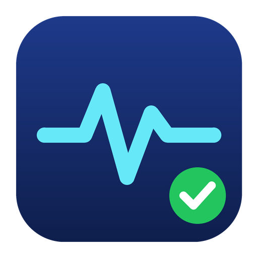

<p align="center">
  
</p>

<h1 align="center">PC Checker</h1>

<p align="center">
  Know what is in your PC, how healthy it is, and what is slowing it down. Then fix it safely.
</p>

<p align="center">
  <a href="https://github.com/Connor-Moyle/test-pcchecker/actions/workflows/ci.yml"></a>
  <a href="https://github.com/Connor-Moyle/test-pcchecker/releases/latest"></a>
  <a href="LICENSE"></a>
  
</p>

PC Checker is a free, open-source desktop app for Windows 11 (and Windows 10
22H2). It scans your hardware, checks component health and temperatures, finds
what is slowing the PC down, cleans junk, manages drivers and installed
software, and walks you through optimisations, with a restore point before
every change and a plain-English explanation of what each change does.

## Highlights

- **Full hardware inventory**: every device and every property Windows knows
  about, searchable and exportable.
- **Health checks**: disk SMART, battery wear, device problems, event-log
  errors, reliability history, crash dumps, memory diagnostics. One score,
  with the reasons.
- **Live temperatures and power**: CPU, GPU, drives, VRM, memory and more, with
  thresholds, alerts, history and an estimated power bill.
- **Drivers**: see what is installed, what is old or unsigned, check Windows
  Update for newer versions, back up and roll back.
- **Software**: everything installed, where it lives, how big it is, and what
  was *installed alongside* something else. Uninstall anything, including
  Store apps.
- **Slowdown scan and one-click fixes**: startup items, services, power plan,
  visual effects, fast startup, TRIM and more. All reversible.
- **Cleanup**: temp files, update caches, browser caches, shader caches, crash
  dumps. Dry-run first. Strict safety rules.
- **Windows features and inbox apps**: enable, disable and remove, with a risk
  label on each.
- **Overclocking** (advanced): NVIDIA GPU tuning, profiles, stress test with a
  temperature watchdog, automatic revert after a crash.
- **In-game overlay**: pick your metrics, position, colours and hotkey.
- **Ask Claude**: optional chat about *your* PC using the scan results, and an
  overclock advisor that produces a step-by-step plan. Bring your own API key.
- **Logs and Action Journal**: everything the app did, and how to undo it.
- **Self-updating** from GitHub Releases, with Stable and Beta channels.

The full tour is in [docs/FEATURES.md](docs/FEATURES.md).

## Install

**Installer (recommended)**: download the `Setup.exe` installer from the
[latest release](https://github.com/Connor-Moyle/test-pcchecker/releases/latest)
and run it. The app updates itself from then on.

**Portable**: download `PcChecker-<version>-portable-win-x64.exe` from the
same page and run it from anywhere. The portable build tells you when a new
version is out but does not update itself.

Requirements: Windows 11 or Windows 10 22H2, 64-bit. Both downloads are
self-contained; no separate .NET install is needed. The app asks for
administrator rights on start because hardware scans, driver installs and
cleanup need them (see [why](docs/FAQ.md#why-does-it-ask-for-administrator-rights)).

> New releases are not yet code-signed, so SmartScreen may show *Windows
> protected your PC*. Click **More info → Run anyway**.

## Screenshots

Screenshots will be added with the first release.

## Safety

PC Checker changes real systems, so it follows four rules without exception:
you confirm every change, a restore point is created first (configurable),
every change is journaled with an undo hint, and cleanup never leaves its
category roots or follows links. Read [docs/SAFETY.md](docs/SAFETY.md) before
using the Optimize, Cleanup, Windows Features or Overclock pages.

## Privacy

Everything stays on your PC. The only network traffic is the update check,
driver downloads through Windows Update, and (only if you set it up) the
Claude assistant. No telemetry, no account. Details in
[docs/PRIVACY.md](docs/PRIVACY.md).

## Build from source

```powershell
git clone https://github.com/Connor-Moyle/test-pcchecker.git
cd test-pcchecker
dotnet build PcChecker.sln -c Release
dotnet test PcChecker.sln
dotnet run --project src/PcChecker.App
```

You need the .NET 8 SDK. The Core tests also run on Linux and macOS. See
[docs/BUILDING.md](docs/BUILDING.md) for publishing and packaging.

## Documentation

| | |
|---|---|
| [Features](docs/FEATURES.md) | What every page does |
| [Safety](docs/SAFETY.md) | The rules behind every change the app makes |
| [Privacy](docs/PRIVACY.md) | What stays local and when the app goes online |
| [Claude integration](docs/CLAUDE-INTEGRATION.md) | Setting up and using the assistant |
| [Overlay](docs/OVERLAY.md) | Metrics, layout, hotkey, limitations |
| [Logging](docs/LOGGING.md) | Log settings and the Action Journal |
| [FAQ](docs/FAQ.md) | Common questions |
| [Building](docs/BUILDING.md) | Build, test, publish, package |
| [Architecture](docs/ARCHITECTURE.md) | How the code is organised |

## Contributing

Bug reports, ideas and pull requests are welcome. Start with
[CONTRIBUTING.md](CONTRIBUTING.md) and the
[Code of Conduct](CODE_OF_CONDUCT.md). Security issues go through
[SECURITY.md](SECURITY.md), not the public tracker.

## Acknowledgements

PC Checker stands on [LibreHardwareMonitor](https://github.com/LibreHardwareMonitor/LibreHardwareMonitor)
for sensors, [NvAPIWrapper](https://github.com/falahati/NvAPIWrapper) for
NVIDIA tuning, [WPF UI](https://github.com/lepoco/wpfui) for the Fluent look,
[Velopack](https://velopack.io) for installs and updates,
[Serilog](https://serilog.net) for logging and the
[Anthropic .NET SDK](https://www.nuget.org/packages/Anthropic) for the
assistant.

## License

[MIT](LICENSE). Copyright (c) PC Checker contributors.
