<p align="center">
  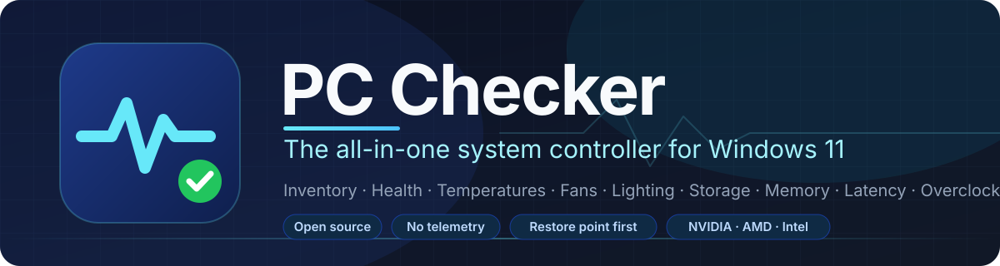
</p>

<p align="center">
  <a href="https://github.com/Connor-Moyle/Pc-Checker/actions/workflows/ci.yml"></a>
  <a href="https://github.com/Connor-Moyle/Pc-Checker/releases/latest"></a>
  <a href="LICENSE"></a>
  
  
</p>

PC Checker is a free, open-source toolkit for Windows 11 that puts everything
about your PC in one place: a full hardware inventory, health checks,
temperatures and power, fan curves, RGB lighting, storage and memory testing,
display, audio, keyboard and mouse settings, drivers, software cleanup, startup
and performance tuning, a latency checker with known fixes, overclocking with
safety rails, an in-game overlay, and a built-in Claude assistant that can
explain what it finds. Every change is confirmed first, protected by a restore
point and written to a journal with an undo hint.

## Contents

- [Download](#download)
- [Screenshots](#screenshots)
- [Feature tour](#feature-tour)
- [Hardware support matrix](#hardware-support-matrix)
- [Safety first](#safety-first)
- [Claude assistant](#claude-assistant)
- [Building from source](#building-from-source)
- [Project structure](#project-structure)
- [Contributing](#contributing)
- [Roadmap](#roadmap)
- [Acknowledgements](#acknowledgements)
- [License](#license)

## Download

**[Download PcChecker.exe](https://github.com/Connor-Moyle/Pc-Checker/releases/latest/download/PcChecker.exe)**
and double-click it. That is the whole install: one file, nothing to set up, and .NET is built in. Run it from
your Downloads folder, a tools folder or a USB stick. On a Windows on Arm PC (Snapdragon), get
**[PcChecker-arm64.exe](https://github.com/Connor-Moyle/Pc-Checker/releases/latest/download/PcChecker-arm64.exe)**
instead; sensors, fan control and GPU tuning are limited there because the hardware drivers they use are x64-only.

Three options start PC Checker with administrator rights without a UAC prompt: *Replace Task Manager*, *Start with
Windows* and schedules. They only work when the exe is in a folder only administrators can change, so another
program cannot swap it. **Settings → General → Install in Program Files** copies PC Checker to
`C:\Program Files\PC Checker`, adds a Start menu shortcut and reopens from there; your settings are kept.

Every release on the [Releases page](https://github.com/Connor-Moyle/Pc-Checker/releases) is that single
`PcChecker.exe` (plus `PcChecker-arm64.exe`), with their SHA-256 checksums in the release notes. The app **updates itself**: when a new version is
out it downloads the new exe, checks the checksum, swaps it in and restarts (Settings → Updates; pick the Beta
channel to get pre-releases).

**Requirements**

- Windows 11, or Windows 10 version 22H2. 64-bit only (x64, or Arm64 with `PcChecker-arm64.exe`).
- No separate .NET install: the .NET 8 runtime is built into `PcChecker.exe`.
- Administrator rights. The app asks for them on every start because reading
  SMART data, controlling fans, installing drivers, cleaning system folders,
  changing services, scheduling `chkdsk` and applying GPU clocks all need
  them. It does not install a service. Nothing runs while it is closed unless
  you turn on a schedule or *Start with Windows*; both are off by default and
  use Windows Task Scheduler, so they need no UAC prompt later.

**About SmartScreen.** Releases are not yet signed with a code-signing
certificate, so the first time you run a new version Windows may show
*Windows protected your PC*. Click **More info → Run anyway**. You can confirm
the file came from this repository by comparing its SHA-256 (`Get-FileHash .\PcChecker.exe`) with the one in
the release notes.

**First run**

1. Accept the administrator prompt.
2. The Dashboard runs a quick health check and shows live temperatures. Click
   **Full scan** to fill every page (hardware, health, performance, software,
   drivers).
3. Open **Settings** to pick a theme, decide whether a restore point is created
   before changes (on by default) and, if you want it, turn on **Advanced
   mode** to reveal the riskier tools.
4. Want to look around without touching anything? Run `PcChecker.exe --demo`
   to explore every page with sample data. See
   [docs/DEMO-MODE.md](docs/DEMO-MODE.md).

## Screenshots

Real screenshots of the app, captured automatically on a Windows runner from demo mode (sample data from a
gaming desktop) every time the app changes. The full set of every page is in
[`docs/screenshots`](docs/screenshots).

<p align="center">
  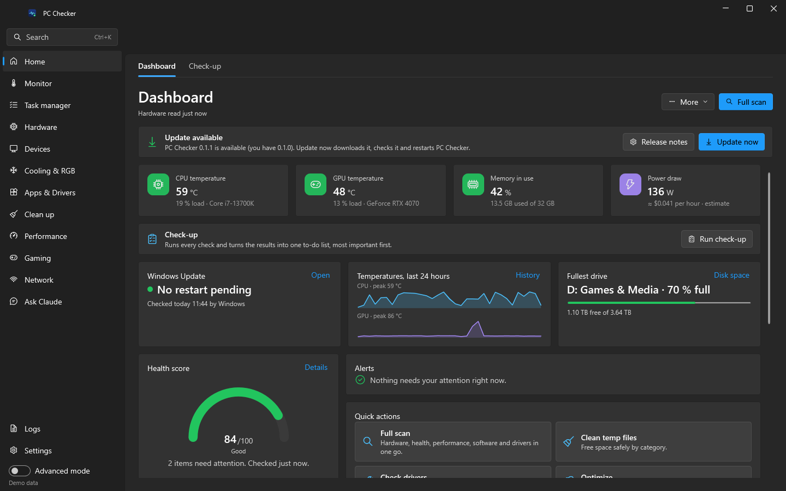
</p>

<table>
  <tr>
    <td width="50%">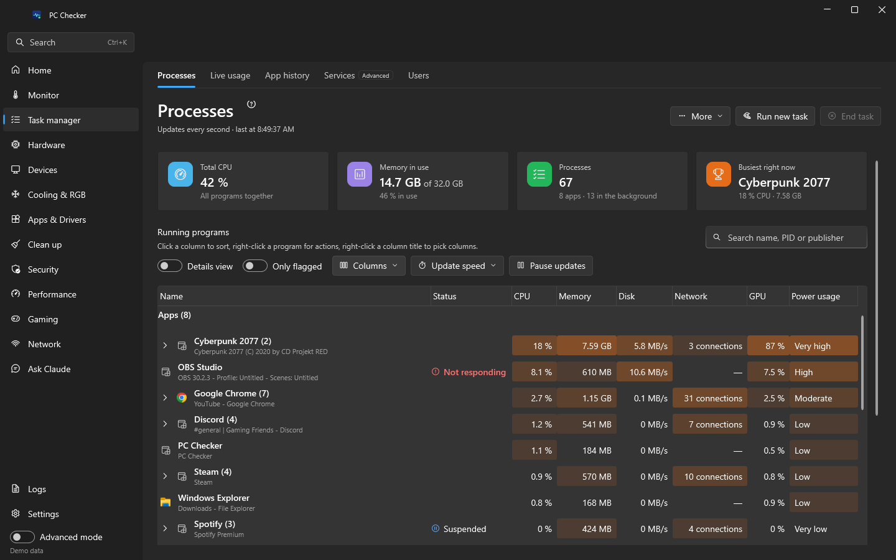<br><sub>Task manager › Processes</sub></td>
    <td width="50%">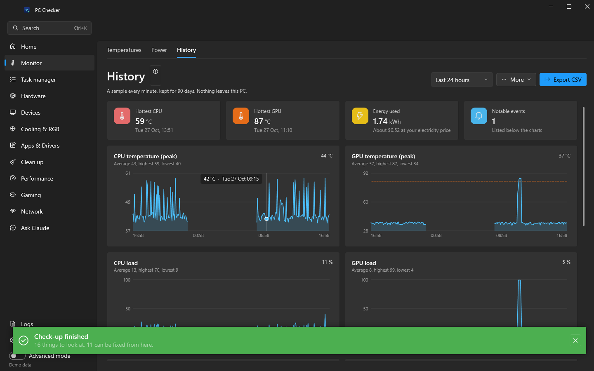<br><sub>Monitor › History</sub></td>
  </tr>
  <tr>
    <td width="50%">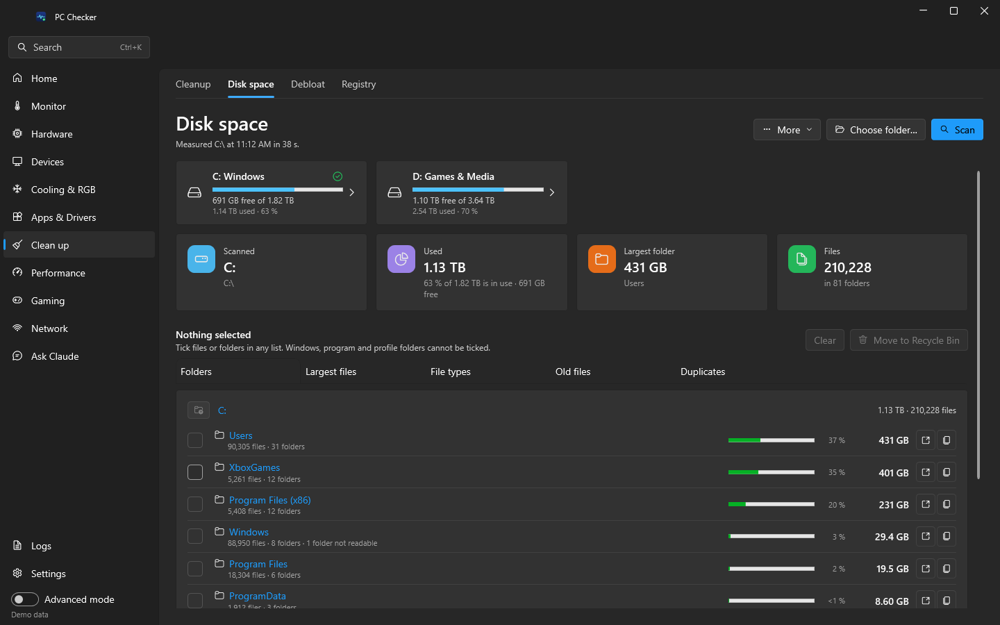<br><sub>Clean up › Disk space</sub></td>
    <td width="50%">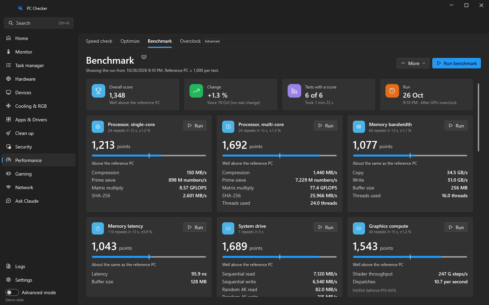<br><sub>Performance › Benchmark</sub></td>
  </tr>
  <tr>
    <td width="50%">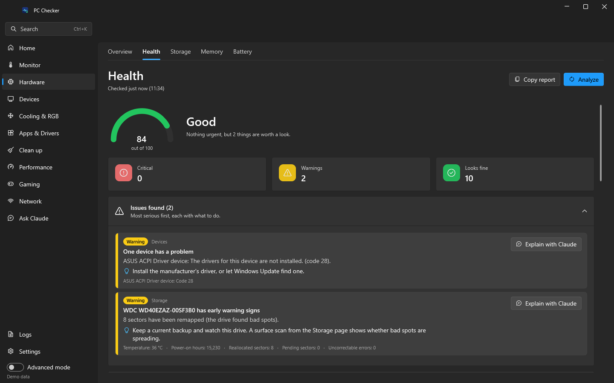<br><sub>Hardware › Health</sub></td>
    <td width="50%">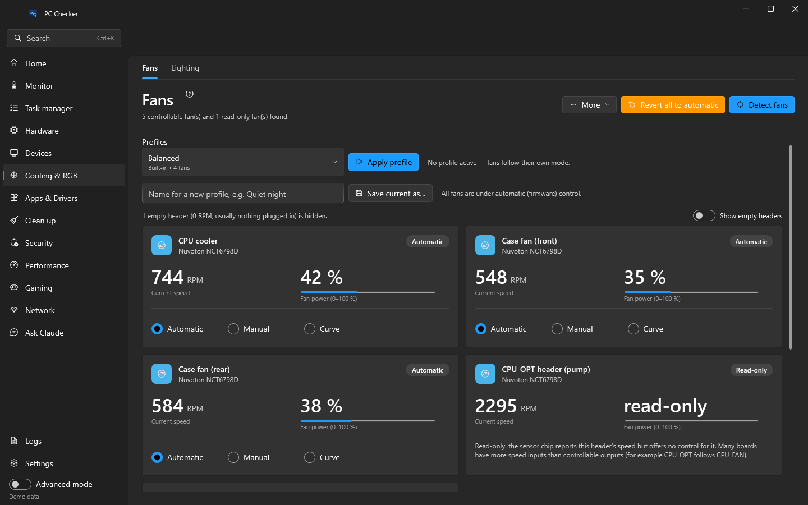<br><sub>Cooling & RGB › Fans</sub></td>
  </tr>
  <tr>
    <td width="50%">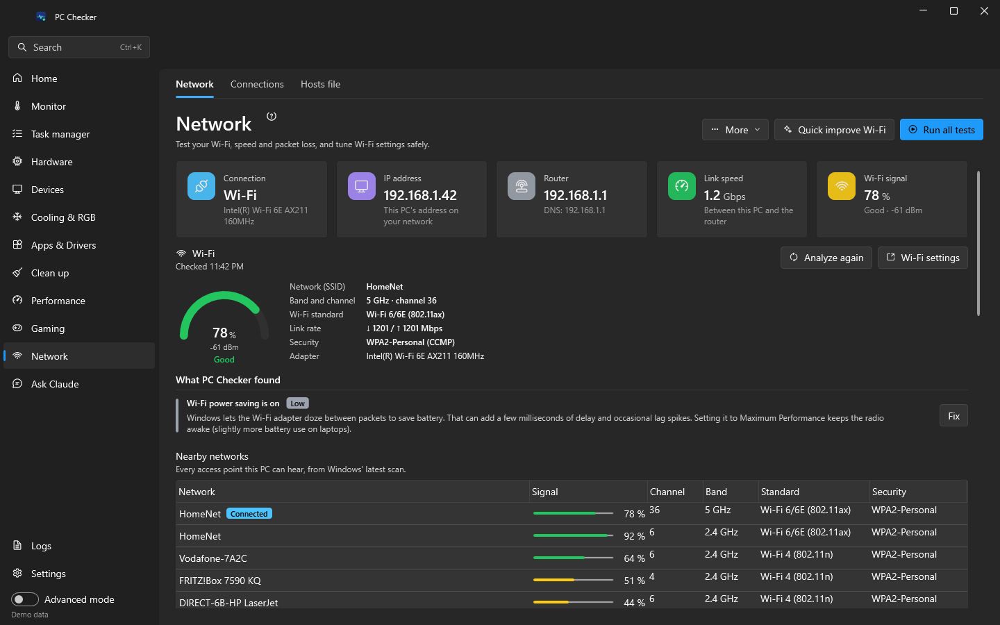<br><sub>Network</sub></td>
    <td width="50%">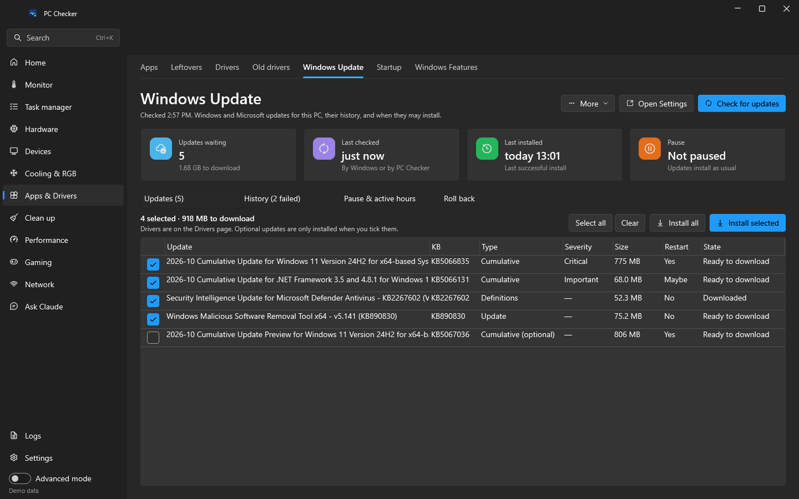<br><sub>Apps & Drivers › Windows Update</sub></td>
  </tr>
  <tr>
    <td width="50%">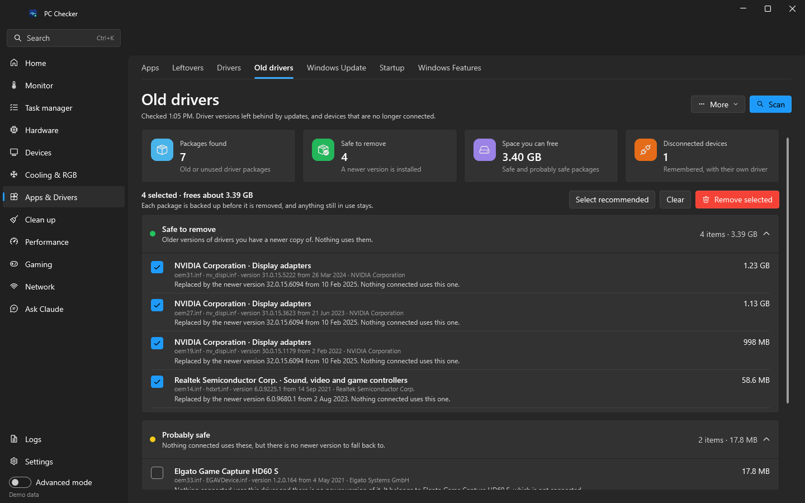<br><sub>Apps & Drivers › Old drivers</sub></td>
    <td width="50%">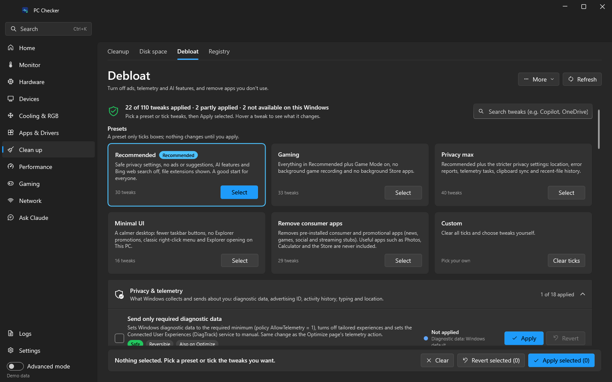<br><sub>Clean up › Debloat</sub></td>
  </tr>
  <tr>
    <td width="50%">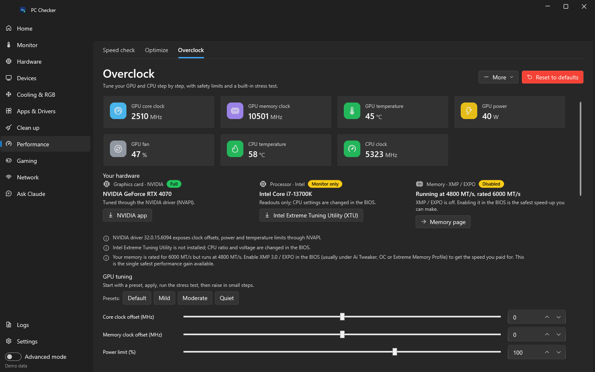<br><sub>Performance › Overclock</sub></td>
    <td width="50%">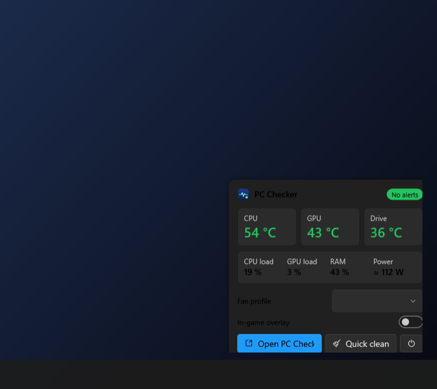<br><sub>Tray popup</sub></td>
  </tr>
</table>

## Feature tour

The side menu has a dozen sections, and a section with several pages shows
them as tabs, so you always know where you are. Press **Ctrl+K** to jump to
any page, tab or setting, or to run a quick action. The full
page-by-page detail, including what every button does and each page's
limitations, is in [docs/FEATURES.md](docs/FEATURES.md).

### Home

| Page | What it does |
|---|---|
| **Dashboard** | Health score, live CPU/GPU temperature, memory and power tiles, Windows Update status, 24-hour CPU and GPU temperature sparklines, the fullest drive, active alerts, quick actions (full scan, clean up, check drivers, optimize), a summary of this PC, the last few journal entries and a collapsible hardware-support table. Export report sits under *More*. |
| **Check-up** | One button runs the health check, a Safe cleanup scan, driver and Windows update checks, startup analysis, the speed check, the recommended privacy settings and the old-driver scan, then shows one ranked to-do list with why each item matters, what fixing it brings, its risk and its page. Safe fixes are ticked; *Fix selected* applies them through their own pages' tools behind a single restore point and shows a result per item. |

### Monitor

| Page | What it does |
|---|---|
| **Temperatures** | Live readings for every sensor your hardware exposes (CPU, GPU, drives, motherboard/VRM, memory, PSU, AIO), with gauges, min/max/average, sparklines, thresholds and alerts. Advanced mode shows every sensor kind (loads, clocks, fans, voltages). |
| **Power** | Per-component watts where sensors exist, an estimated total (clearly marked as an estimate when there is no PSU sensor), battery discharge, session energy and cost at your electricity price, and power-plan switching. |
| **History** | Up to 90 days of temperatures, loads, power, memory, free space and health scores, recorded in the background (also from the tray) and kept only on your PC. Charts per metric with hover values, a list of notable events such as temperature peaks and sudden drops in free space, and CSV export. |
| **Crashes** | Blue screens, sudden shutdowns, graphics driver resets and app crashes from the last 90 days on one timeline, read from the event logs and memory dumps on any Windows language. Each one says what it means, which driver probably caused it (a best guess from the dump), what to try first and which page helps, with *Ask Claude about this crash*, Event Viewer and the dump folder one click away, plus the most crashing apps. |

### Task manager

| Page | What it does |
|---|---|
| **Processes** | A Task Manager replacement: Apps, Background and Windows processes (or a flat Details view) with status, CPU, memory, disk, network connections, GPU and engine, power usage and a plain-English *what is this?*, heat-map shading and your own columns; end task (closes politely first), restart, suspend and resume, efficiency mode, priority, affinity, switch to, memory dump, properties and *Run new task*. Windows' core processes are never touched. |
| **Live usage** | Task Manager's Performance tab: CPU, memory, every disk (SSD, HDD or NVMe, with drive letters), every active network adapter and every graphics card, each with a sparkline and a 60-second graph, plus the same details Task Manager shows (speed, cores and caches, memory composition, disk response time, Wi-Fi name and signal, GPU engines, memory, driver and temperature). One graph per processor, kernel time, Ctrl+C to copy, and a compact always-on-top window from the page or the tray. |
| **Services** | Every Windows service with its display name, service name, description, status, startup type (Automatic, Automatic (Delayed), Manual, Disabled), log-on account, PID and group; search and filters (running, stopped, other companies only, disabled); start, stop, restart, pause, continue and change the startup type; open the Services console or the file, search online, go to the process, and show what depends on it. Core Windows services are locked with a plain reason; every change is confirmed and journaled, a startup-type change with the previous type so it can be set back. |
| **Users** | Everyone signed in to the PC — user, session, state, client and sign-in time — with each person's summed processor and memory use. Switch user (locks to the sign-in screen), disconnect, sign another user out (confirmed, admin), and send a short on-screen message. |
| **Replace Task Manager** | An option (Settings → General, and the Processes *More* menu) that makes Ctrl+Shift+Esc and every other way of opening Task Manager open PC Checker on the Processes tab instead, the way Process Explorer does. Only available from a Program Files install (Settings → General → *Install in Program Files* puts it there), confirmed and journaled, and fully reversible; a leftover setting from an old copy is cleaned up at start, and one pointing at another copy is offered to be fixed. *Open Windows Task Manager* turns it off first, and *Startup apps* in the same menu opens Apps & Drivers › Startup. |

### Hardware

| Page | What it does |
|---|---|
| **Overview** | Every device Windows knows about with typed, human-labelled fields and the raw property bag underneath. Search, export as JSON, copy a summary. |
| **Health** | Disk SMART, battery wear, device problems, event-log errors, reliability history, crash dumps, memory-diagnostic results, Windows Update state, free space, thermals and security basics, scored out of 100 with the reasons. |
| **Storage** | Every drive once, read correctly (SATA and NVMe, USB, SD, Storage Spaces and their pool members, RAID, offline and empty disks) with capacity in TB and TiB, HDD or SSD with RPM, link speed, serial, partition style, decoded SMART and a Good / Caution / Bad verdict with the reason; sleeping drives are never woken. Read-only surface scan (quick or full) with a live block map, disk benchmark (sequential and random 4K), `chkdsk` scan or scheduled repair, `Repair-Volume`, TRIM or defragment, recent disk error events explained, and links to your drive vendor's tool. |
| **Memory** | Usage, commit, standby and cache, compression and SysMain state, page files, module list, XMP/EXPO status with BIOS guidance, channel layout, an in-app memory test, Windows Memory Diagnostic scheduling, standby-list clearing, memory profiles and a manual page-file editor. |
| **Battery** | Battery health against the design capacity, charge cycles, how long a full charge lasts now and when new, a capacity history chart and the last three days of use from Windows' battery report, tips such as charge limits, and the full HTML report in one click. Desktops get a clear "no battery" message. |

### Devices

| Page | What it does |
|---|---|
| **Displays** | Arrangement preview with identify, resolution and refresh rate with a keep-or-revert countdown, orientation, primary display, HDR, brightness and contrast over DDC/CI or the laptop panel, display profiles, and shortcuts to Windows, Night light, colour calibration and your GPU control panel. |
| **Audio** | Output and input devices with volume, mute and live level meters, default and communications device, a per-app mixer, audio service restart and the troubleshooter. |
| **Keyboard & Mouse** | Pointer speed, Enhance pointer precision (acceleration), double-click, scroll, trails, keyboard repeat and cursor blink, accessibility toggles, profiles (Windows default, Gaming, Precision, Accessibility), a mouse polling-rate meter and links to your peripheral vendor's software. RGB for peripherals lives on the Lighting page. |

### Cooling & RGB

| Page | What it does |
|---|---|
| **Fans** | Detects every fan LibreHardwareMonitor can control (motherboard headers, GPU fans, some coolers). Manual speed, custom curves with hysteresis and ramp limiting, Silent/Balanced/Performance profiles, revert to automatic on exit and after a crash, and a failsafe that forces 100 % if a part overheats. Laptops and OEM boards often expose no controllable fans; the page says so plainly. |
| **Lighting** | RGB control through [OpenRGB](https://openrgb.org): motherboards, RAM, GPUs, keyboards, mice, coolers and strips. Per-device modes, colours, zones (including the LED count of addressable headers), brightness and speed, sync-all, turn-off-all, profiles. Lists every RGB device it finds even without OpenRGB (USB and graphics card IDs, RGB memory, Dynamic Lighting devices) with a plain status, spots iCUE, Armoury Crate and other apps that hold devices and can close them for the session, and can start or install OpenRGB. |

### Apps & Drivers

| Page | What it does |
|---|---|
| **Apps** | Programs and Store apps with size, location and install date. Detects what was *installed alongside* something else, groups runtime dependencies so they are not mistaken for bloat, protects critical components, and uninstalls quietly or with the vendor's own wizard. |
| **Leftovers** | Finds what removed programs left behind: unused and empty folders in Program Files, ProgramData and AppData, their registry keys, services and scheduled tasks pointing at missing programs, and dead Start menu shortcuts, each with why it looks orphaned, its size and a High/Medium/Low confidence. Offered right after an uninstall. Removes the ticked ones behind a restore point (Recycle Bin for files, `.reg` and XML backups with a restore list for keys and tasks). |
| **Drivers** | Every installed driver with version, date, signature and problem code; flags old, unsigned and faulty ones. Searches Windows Update, NVIDIA, AMD, Intel and your PC maker's tools side by side, shows each source's newest version per device and lets you pick the source; vendor packages come only from the maker's servers and run only when signed by the maker, after you confirm and a restore point. Backs up all drivers, installs a `.inf`, and opens your PC maker's tool or support page for your exact model. The **Old drivers** tab finds driver versions left behind by updates, packages no device uses and drivers of devices that are no longer connected, shows the space they take, and removes the ones you pick after backing each one up. |
| **Drivers › Your PC** | Your board or PC model, BIOS version and age (with a hint when it is over two years old) and the chipset driver against the maker's newest: AMD Chipset Software is compared with AMD's chipset page for your socket and can be installed from AMD's server, Intel chipsets link to Intel. One click opens your board's or PC's support page with the exact model filled in (ASUS, MSI, GIGABYTE, ASRock, Dell by service tag, Lenovo, HP and more). Network, audio and Bluetooth devices link to Intel, Realtek or your board maker, and Lenovo PCs are compared with Lenovo's own driver and BIOS catalog. BIOS updates are shown, never run. |
| **Windows Update** | Last check and install, pending restart, pause and policy status at a glance. Lists waiting software updates with KB, size, type and severity and installs the ones you pick one at a time behind a restore point, with every failure explained in plain English. Shows the last 100 installs with failed ones highlighted, pauses updates for 1–5 weeks or sets active hours the way Settings does, and stays read-only where Group Policy or device management is in charge. **Roll back** removes an installed update (wusa, or DISM for the combined cumulative update; servicing stack updates are refused), hides updates so Windows does not reinstall them, and goes back to the previous Windows version while the window lasts, with the days left and a longer window. |
| **Startup** | Startup apps from the registry, startup folders and logon tasks with enable, disable, add and remove; auto-start services (advanced); boot options: fast startup, boot-menu timeout, safe mode next boot, restart to UEFI or advanced startup. |
| **Scheduled tasks** | Every Task Scheduler task with when it runs in plain words ("At log on", "Daily at 03:00"), last result, next run, what it runs and as whom. Shows other companies' tasks first and flags the suspicious ones with a reason (runs from AppData or Temp, encoded scripts, hidden, unsigned). Run, end, turn off or on, and delete other companies' tasks with a saved copy you can restore; Windows' own tasks are read-only outside Advanced mode. |
| **Windows Features** | Optional features, capabilities and inbox apps with risk labels and notes on what removing each one affects. |

### Clean up

| Page | What it does |
|---|---|
| **Cleanup** | Junk by category in seven groups: Windows (temp, update caches, logs, crash and GPU timeout dumps), graphics drivers (AMD, NVIDIA and Intel shader caches and installer leftovers), 14 browsers, apps, game launchers, developer caches and opt-in privacy items, plus DISM, Disk Cleanup and restore point cleanup through Windows' own tools. Dry run first, apps must be closed, strict safety rules. |
| **Disk space** | What fills a drive or folder: drive bars, a size-sorted folder drill-down, the largest files, a breakdown by type, old big files and a duplicate finder (size, quick hash, SHA-256) with keep-newest and keep-oldest. Moves what you pick to the Recycle Bin and never offers Windows, program or profile folders. |
| **Debloat** | 375 privacy, ads, AI/Copilot, telemetry, taskbar, Explorer, preference, Edge/OneDrive, browser and Office, gaming, update, service, automatic-install, AMD & NVIDIA software and app-removal (including PC-maker) tweaks gathered from WinUtil, Win11Debloat, O&O ShutUp10++, Sophia Script and other popular tools. Presets (Recommended, Gaming, Privacy max, Minimal UI, consumer apps), live state per tweak, one restore point per batch, saved previous values for revert, WinUtil import. Disabling Defender or Windows Update and removing Edge or the Store are deliberately not offered. See [docs/DEBLOAT.md](docs/DEBLOAT.md). |
| **Right-click menu** | Everything programs added to File Explorer's right-click menu (files, folders, drives, desktop, common file types, Send to and Windows 11 app entries) with the program, publisher and where it shows. Turns entries off and on without deleting them, marks ones whose program is gone, keeps Windows' own entries read-only, switches Windows 11 to the full menu, and restarts File Explorer. |
| **Registry** | Finds leftover entries that point at programs, files and folders that are gone (uninstall entries, App Paths, startup entries, MUI cache, file associations, fonts, help files and more), backs each one up to a `.reg` file and creates a restore point before removing it, and restores any fix from the Backups list. Honest by design: tidies things up, does not promise speed. See [docs/REGISTRY.md](docs/REGISTRY.md). |

### Security

| Page | What it does |
|---|---|
| **Security** | A traffic light for each protection in plain words: Microsoft Defender (or your other antivirus), firewall, Windows version and its end of support, paused updates, User Account Control, SmartScreen, SMB 1.0, drive encryption, Secure Boot, TPM, memory integrity, activation, Remote Desktop and the Guest account, with a score out of 100 and the three things to fix first. Quick and full Defender scans, definition updates and recent threats; safe fixes (firewall on, SMB 1.0 off) ask first, everything else opens the Windows setting. |
| **Privacy** | Which apps used the camera, microphone and location, when, for how long and which are using them right now; turn one Store app's access off with Undo, and see activity history, advertising ID and diagnostic data with a link to the Debloat tweak that changes them. |

| **Backups** | Restore points with type and maker, create and delete (the newest only after a second warning), System Protection and its space per drive with Turn on and a size limit, File History, OneDrive folder backup and system image status, and PC Checker's own backup folders with count, size, *Open folder* and *Delete old ones* (to the Recycle Bin). Hints when protection is off, the newest point is over 30 days old or the space is under 1 GB. |
### Performance

| Page | What it does |
|---|---|
| **Speed check** | A slowdown scan: startup items, services, hungry processes, memory and disk pressure, power plan, fast startup, visual effects, boot time, HDD vs SSD and TRIM, pending updates and throttling. Findings are prioritised and each links to its fix. |
| **Optimize** | Reversible tweaks grouped by risk: power plan, visual effects, Game Mode, background apps, Storage Sense, TRIM, hibernation, service modes, and in Advanced mode DNS, telemetry, SysMain, indexing, `DISM`, `sfc` and network reset. Also hosts the actions contributed by Latency, Memory, Startup and Keyboard & Mouse. |
| **Benchmark** | Scores the processor (single- and multi-core), memory bandwidth and latency, the Windows drive and the graphics card against a mid-range 2024 desktop (1,000 per test), with an overall score. Warns when the PC is on battery, hot or busy, keeps every run, compares any two runs with the change in percent, and exports results as text. |
| **Overclock** | NVIDIA tuning through NVAPI (core and memory offsets, power and temperature limits where the driver exposes them, fan percent). AMD GPUs through ADL/Overdrive8 and Intel Arc through IGCL are **experimental** and fall back to the vendor's software. CPU tuning goes through Intel XTU or AMD Ryzen Master when installed, otherwise BIOS guidance. XMP/EXPO detection, profiles, a stress test with a temperature watchdog, automatic revert after an unclean shutdown, a safety validator that clamps every value, a support matrix and a consent gate. The stress test loads the GPU itself with a built-in DirectX 11 compute workload (NVIDIA, AMD and Intel, integrated graphics included) and checks every result for errors, catches graphics-driver resets, and still offers a *guided* mode for your own game or benchmark. |

### Gaming

| Page | What it does |
|---|---|
| **Overlay** | A click-through, always-on-top in-game panel. Pick metrics (including an FPS counter with frame time and 1% low), corner or custom position, opacity, scale, fonts, colours and presets; toggle it with a global hotkey. Game profiles switch the overlay preset, fan profile and power plan automatically while a game runs and put them back when it closes. Works over borderless and windowed games; exclusive full-screen games hide every desktop window, including this one. |
| **Latency** | Samples DPC and interrupt time, reads timer resolution, HPET and dynamic tick, HAGS, power plan, core parking, USB and PCIe power saving, Game Mode, pointer precision and mouse polling rate, pings your gateway and public DNS, times a DNS lookup, then scores it and offers the known fixes. Real-time DPC tracing still needs LatencyMon or Windows Performance Analyzer; the page says so and links them. |
| **Missing DLLs** | Lists about 240 DLLs old games ask for (d3dx9, xinput, msvcp140, msvcr100, OpenAL32, PhysXLoader…) with their 32 and 64-bit state, and scans a game's folder for the DLLs its programs load. *Install* puts the official package on the PC (DirectX June 2010, Visual C++ 2005 to 2022, .NET 3.5, DirectPlay, XNA, OpenAL, PhysX) from Microsoft, NVIDIA or Creative after checking its signature. Never single DLL files from DLL websites. |

### Network

| Page | What it does |
|---|---|
| **Network** | Wi-Fi analysis (signal and dBm, band, channel, standard, link rate, security, nearby networks and channel congestion, plain-English findings), an HTTP speed test with ping under load and a bufferbloat grade, a packet loss test, adapter error counters, flush DNS / renew IP / reset network stack, and reversible Wi-Fi tuning: power saving, adapter driver settings with recommendations, TCP settings, fast or encrypted DNS, saved networks, and a "Quick improve Wi-Fi" checklist with a before/after comparison. |
| **Connections** | A live, TCPView-style list of every TCP and UDP connection per program (IPv4 and IPv6) with ports, state and optional host names, refreshed every 2 seconds. Points out programs that accept connections from other devices, and can copy, search an address, go to the process, close a connection or end the program. |
| **Hosts file** | The hosts file as a table and as text: add, edit, turn off and remove entries, block a site in one step, and see entries that look like malware (redirected bank or Microsoft sites, blocked security updates). Every save asks first, keeps a dated backup, keeps the encoding and comments, and clears the DNS cache; undo, restore and reset to the Windows default. |

### Ask Claude

| Page | What it does |
|---|---|
| **Ask Claude** | Chat about *this* PC with the scan results as context, get plain-English explanations of findings, and draft a staged overclocking plan you apply one step at a time. Optional; nothing is sent until you add an API key and press send. |

### Logs and Settings

| Page | What it does |
|---|---|
| **Logs** | Live log viewer with per-category levels, filters and a diagnostics zip export, plus the Action Journal: every change the app made, when, and how to undo it. |
| **Settings** | Theme, advanced mode, startup behaviour, updates and channel, tray options, schedules, restore-point policy, temperature thresholds, electricity price, fans, lighting, latency targets, overclock safety limits, memory and startup warnings, the Claude connection, data and privacy tools, and About. Overlay options live on the Overlay page, logging options on the Logs page and cleanup categories on the Cleanup page. |

### In the background

| Feature | What it does |
|---|---|
| **Tray** | An icon next to the clock with CPU and GPU temperatures in its tooltip (or the hottest one drawn as the icon). Click it for a compact popup with temperatures, load, RAM, power draw, alerts, a fan-profile switch, the overlay toggle and *Quick clean*; right-click for a menu. Minimize or close to the tray, start with Windows (straight into the tray if you like) without a UAC prompt, and get temperature alerts as notifications while the window is hidden. |
| **Quick search** | Press Ctrl+K (or *Search* at the top of the menu) to jump to any page, tab or setting, or to run a quick action such as a full scan, a cleanup or a latency check. Fuzzy matching on words and initials, recent items first, and it understands the interface language. New users get a short welcome with the language choice and an Advanced mode explanation. |
| **Help and undo** | *What needs attention* at the top of the Dashboard lists up to five plain-language recommendations, each with one button. Every page has a **?** button (or F1) that says what it does and the safest first step, **?** lists every keyboard shortcut, F5 refreshes or scans the page, and a reversible change's notification offers **Undo** for 10 seconds. |
| **Your setup** | Back up every setting and profile (fans, lighting, overlay, games, displays, keyboard and mouse, overclock, schedules, optionally the benchmark history) to one `.pcchecker` file, and restore it with a preview of what each part changes. Never includes your API key; backs up the current setup before every import and lets you undo it, and resets single parts to their defaults. |
| **Schedules** | Health checks, Safe-only junk cleanup, driver update checks and HTML reports on a daily or weekly timetable through Windows Task Scheduler, so they run even while the app is closed. You get a notification only when something needs attention (a score drop, a new critical problem, driver updates, a failed run), and each job shows its next run, last result and *Run now* in Settings. |

## Hardware support matrix

PC Checker never silently does nothing. Each feature shows its support level
on your machine with a one-line reason, and unsupported paths fall back to
launching the vendor's own software. The levels are:

- **Full**: the app reads and changes it directly.
- **Experimental**: implemented against the vendor's public SDK but not yet
  verified on a wide range of hardware. Every value is validated against the
  driver's own limits. Please report what works.
- **Monitor only**: the app shows readings but cannot change anything.
- **Via vendor software**: the app detects the vendor tool, launches it or
  links its download, and explains the BIOS steps where that is the only way.

| Feature | NVIDIA | AMD | Intel | Other / notes | Mechanism |
|---|---|---|---|---|---|
| Sensors and temperatures | Full | Full | Full | Full for motherboard chips (Nuvoton, ITE, Fintek), NVMe/SATA drives, memory, many PSUs and AIOs. Laptops and OEM boards often expose few sensors; virtual machines almost none. | LibreHardwareMonitor |
| Fan control | Full (GPU fans) | Full (GPU fans) | Monitor only (Arc fans) | Full for motherboard headers on supported Super I/O chips and some coolers; usually unavailable on laptops and OEM boards. | LibreHardwareMonitor controls |
| GPU overclocking | Full (offsets); power and temperature limits where the driver exposes them | Experimental | Experimental (Arc); Monitor only (integrated graphics) | Falls back to NVIDIA app, AMD Software: Adrenalin Edition or Intel Graphics Software. | NVAPI, ADL/Overdrive8, IGCL |
| CPU tuning | n/a | Via vendor software | Via vendor software | Intel: XTU CLI when installed. AMD: Ryzen Master launch; optional `ryzenadj` for power limits on mobile and APU parts. Otherwise BIOS guidance. The app never writes MSRs or BIOS settings itself. | XTU CLI, Ryzen Master, ryzenadj |
| Memory (XMP/EXPO) | n/a | Monitor only | Monitor only | Detects rated vs configured speed and tells you how to enable the profile in BIOS; enabling it is BIOS-only on every platform. | WMI |
| RGB lighting | Via OpenRGB (partner cards) | Via OpenRGB (partner cards) | Via OpenRGB | Via OpenRGB for motherboards, RAM, keyboards, mice, coolers and strips the OpenRGB project supports; vendor suites (Armoury Crate, MSI Center, iCUE, Synapse, G HUB and others) are linked as alternatives. | OpenRGB SDK over a local socket |
| Display control | Full | Full | Full | Resolution, refresh rate, orientation, primary and HDR through Windows; brightness and contrast through DDC/CI on external monitors that answer, or WMI on laptop panels. Variable refresh rate is controlled in Windows Graphics settings. | Windows display APIs, DDC/CI |
| Drivers | Full | Full | Full | Windows Update driver catalog for every device; NVIDIA and AMD Adrenalin graphics packages and AMD chipset software downloaded straight from the maker, signature-checked and installed after a restore point; newest-version comparison with AMD's chipset page and Lenovo's driver and BIOS catalog; links and the maker's own update tools for Intel and other board and PC makers. The app never downloads from third-party driver sites. | Windows Update Agent, pnputil |

The same table with more detail, including which chips and which SDK calls
are involved, is in [docs/SUPPORTED-HARDWARE.md](docs/SUPPORTED-HARDWARE.md).

## Safety first

PC Checker runs as administrator and can change real things. It follows these
rules without exception; read [docs/SAFETY.md](docs/SAFETY.md) for the full
list.

- **You confirm first.** No uninstall, delete, service change, registry edit,
  feature toggle, driver install, page-file change, `bcdedit` call, fan
  override or overclock happens without a dialog that says what will change.
- **A restore point comes first.** Created before any system change by
  default (Settings → Restore points).
- **Everything is journaled.** The Action Journal on the Logs page records
  what changed, when, the result, the restore point number and how to undo it.
- **Watchdogs.** Fans return to automatic on exit and after a crash; an
  overclock that was active during an unclean shutdown is reset on the next
  start; the stress test aborts above your temperature limits or when the
  graphics driver resets, and resets an active overclock to defaults.
- **Advanced mode.** The riskier tools (HPET and dynamic tick, Nagle, MSI
  mode, `DISM`, `sfc`, network reset, workstation memory profile, raw sensor
  lists, protected-software override) stay hidden until you turn it on.

## Claude assistant

The **Ask Claude** page is optional. Bring your own
[Anthropic API key](https://console.anthropic.com/), paste it on the Ask Claude page (Settings links there), and
the assistant can answer questions about your PC using the scan results as
context ("why is my boot slow?", "is this drive failing?"), explain any finding
in plain English, and draft a staged overclocking plan that the safety
validator clamps before you see it.

Privacy in short: nothing is sent until you add a key and press send; the
context is a trimmed text summary of your scans that you can read before it
goes; serial numbers and MAC addresses can be redacted; the key is stored with
Windows DPAPI for your user account only. Details, costs and troubleshooting
are in [docs/CLAUDE-INTEGRATION.md](docs/CLAUDE-INTEGRATION.md).

## Building from source

```powershell
git clone https://github.com/Connor-Moyle/Pc-Checker.git
cd Pc-Checker
dotnet build PcChecker.sln -c Release
dotnet test PcChecker.sln -c Release
dotnet run --project src/PcChecker.App
```

You need the .NET 8 SDK. The solution also builds, and the Core tests run, on
Linux and macOS; only the app itself needs Windows. Publishing the single
`PcChecker.exe`, versioning and the local `build/publish.ps1` script are covered in
[docs/BUILDING.md](docs/BUILDING.md).

## Project structure

```
src/PcChecker.Core/      contracts, models, pure logic, Windows and Demo implementations (no UI)
src/PcChecker.Claude/    the assistant, built on the official Anthropic SDK
src/PcChecker.App/       the WPF application (Fluent UI, MVVM)
tests/PcChecker.Core.Tests/  xUnit tests for the pure logic
build/                   icon source, the icon script and the local publish script
docs/                    documentation and CI-captured screenshots
```

How the layers fit together, the app modes, the shared hardware-monitor host
and the module boundaries are described in
[docs/ARCHITECTURE.md](docs/ARCHITECTURE.md).

## Documentation

| | |
|---|---|
| [Features](docs/FEATURES.md) | Every page, every button, every limitation |
| [Supported hardware](docs/SUPPORTED-HARDWARE.md) | The support matrix in detail |
| [Safety](docs/SAFETY.md) | The rules behind every change the app makes |
| [Privacy](docs/PRIVACY.md) | What stays local and when the app goes online |
| [Claude integration](docs/CLAUDE-INTEGRATION.md) | Setting up and using the assistant |
| [Overlay](docs/OVERLAY.md) | Metrics, FPS counter, game profiles, layout, hotkey, limitations |
| [Logging](docs/LOGGING.md) | Log settings, diagnostics export and the Action Journal |
| [Demo mode](docs/DEMO-MODE.md) | Exploring the app safely and capturing screenshots |
| [FAQ](docs/FAQ.md) | Common questions |
| [Translating](docs/TRANSLATING.md) | Interface languages and how to improve a translation |
| [Accessibility](docs/ACCESSIBILITY.md) | Keyboard shortcuts (Ctrl+K, F6, Ctrl+Tab, access keys), screen readers, contrast, high contrast, known gaps |
| [UI guidelines](docs/UI-GUIDELINES.md) | How pages are laid out |
| [Building](docs/BUILDING.md) | Build, test, publish, package, release |
| [Architecture](docs/ARCHITECTURE.md) | How the code is organised |
| [Third-party notices](docs/THIRD-PARTY-NOTICES.md) | Open-source components and their licences |

## Contributing

Bug reports, ideas and pull requests are welcome. Start with
[CONTRIBUTING.md](CONTRIBUTING.md) and the
[Code of Conduct](CODE_OF_CONDUCT.md). Hardware reports are especially useful:
if a fan, sensor, GPU or RGB device is not detected, open a
[driver or hardware issue](https://github.com/Connor-Moyle/Pc-Checker/issues/new?template=driver_or_hardware_issue.yml)
with your log export. Security problems go through [SECURITY.md](SECURITY.md),
not the public tracker.

## Roadmap

- [ ] Promote AMD GPU tuning (ADL/Overdrive8) from experimental to full once
      verified on RDNA 2, RDNA 3 and RDNA 4 cards
- [ ] Promote Intel Arc tuning (IGCL) from experimental to full
- [x] FPS counter in the overlay
- [x] Built-in GPU load generator so the GPU stress test no longer needs a game
- [x] Per-game overlay and fan profiles that switch automatically
- [x] Tray mode with a compact temperature popup
- [x] Scheduled health checks and cleanup
- [x] Localization: German, Spanish, French, Italian and Brazilian Portuguese
      (see [docs/TRANSLATING.md](docs/TRANSLATING.md))
- [ ] Code-signed releases (the release workflow signs automatically once a
      code-signing certificate is added as a repository secret)
- [x] ARM64 build for Windows on Arm

## Acknowledgements

PC Checker stands on the shoulders of these projects:

- [LibreHardwareMonitor](https://github.com/LibreHardwareMonitor/LibreHardwareMonitor) (MPL-2.0): sensors, SMART and fan controls
- [NvAPIWrapper](https://github.com/falahati/NvAPIWrapper) (LGPL-3.0): NVIDIA tuning
- [OpenRGB](https://openrgb.org) and [OpenRGB.NET](https://github.com/diogotr7/OpenRGB.NET) (GPL-2.0 / MIT): RGB lighting
- [NAudio](https://github.com/naudio/NAudio) (MIT): Core Audio device and session control
- [Vortice.Windows](https://github.com/amerkoleci/Vortice.Windows) (MIT): Direct3D 11 compute for the built-in GPU stress test
- [System.Diagnostics.PerformanceCounter](https://www.nuget.org/packages/System.Diagnostics.PerformanceCounter) (MIT): DPC, interrupt and memory counters
- [WPF UI](https://github.com/lepoco/wpfui) (MIT): the Fluent look
- [CommunityToolkit.Mvvm](https://github.com/CommunityToolkit/dotnet) (MIT): view models
- [Serilog](https://serilog.net) (Apache-2.0): logging
- [Anthropic C# SDK](https://www.nuget.org/packages/Anthropic) (MIT): the assistant

## License

[MIT](LICENSE). Copyright (c) 2026 Connor Moyle and PC Checker contributors.
